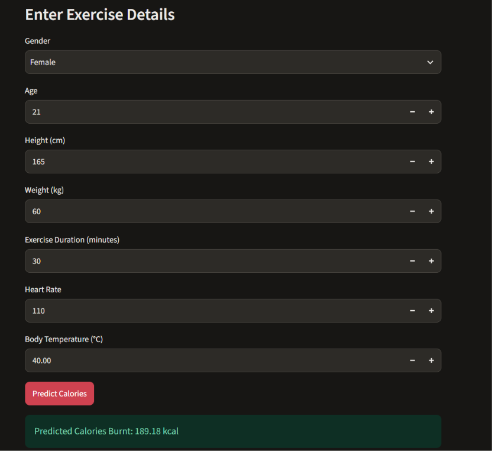

# 🔥 Calories Burnt Prediction
## 📸 Application Preview



A Machine Learning project that predicts the estimated number of calories burnt during exercise using personal and exercise-related information.

The project compares multiple regression algorithms, selects the best-performing model, and deploys it as an interactive web application using Streamlit.

## 🚀 Live Demo

[Try the Calories Burnt Predictor](https://calories-burnt-prediction-dq6sy4tfnfgxydojyocsxc.streamlit.app/)

## 📌 Project Overview

The goal of this project is to build a regression model that estimates calories burnt during exercise based on:

- Gender
- Age
- Height
- Weight
- Exercise duration
- Heart rate
- Body temperature

The trained model is integrated into a Streamlit application where users can enter these details and receive a prediction.

## 🛠️ Technologies Used

- Python
- Pandas
- NumPy
- Matplotlib
- Seaborn
- Scikit-learn
- Joblib
- Streamlit

## 🧠 Machine Learning Workflow

1. Loaded and merged the calories and exercise datasets using `User_ID`.
2. Explored the data and checked for missing values and duplicate records.
3. Encoded gender as numerical values.
4. Separated input features and the target variable.
5. Split the data into training and testing sets (80:20).
6. Applied feature scaling where required.
7. Trained and evaluated four regression algorithms.
8. Compared model performance using MAE, RMSE and R².
9. Selected the best-performing model based on Mean Absolute Error.
10. Saved and compressed the trained model for deployment.

## 📊 Model Performance

The models were evaluated on the test dataset.

| Model | MAE | RMSE | R² |
|---|---:|---:|---:|
| Linear Regression | 8.44 | 11.49 | 0.9673 |
| Random Forest | **1.72** | **2.67** | **0.9982** |
| Lasso Regression | 9.14 | 12.56 | 0.9609 |
| Ridge Regression | 8.44 | 11.49 | 0.9673 |

**Best Model: Random Forest Regressor**

Random Forest achieved the lowest MAE and was selected for the final application.

## 🌐 Streamlit Web Application

The application allows users to enter exercise details and receive an estimated calorie-burn prediction.

The saved model is loaded using Joblib from a compressed `.gz` file. The application also preserves the original feature order and applies scaling only when required by the selected model.

## 📁 Repository Structure

```text
calories-burnt-prediction/
│
├── Calories_Burnt_Prediction.ipynb
├── app.py
├── calories_model.pkl.gz
├── requirements.txt
├── runtime.txt
└── README.md
```

## 💻 Run Locally

1. Clone this repository:

```bash
git clone https://github.com/hasini0304/calories-burnt-prediction.git
```

2. Navigate to the project directory:

```bash
cd calories-burnt-prediction
```

3. Install the dependencies:

```bash
pip install -r requirements.txt
```

4. Run the Streamlit application:

```bash
streamlit run app.py
```

The application will open in your browser.

## 📓 Notebook

The Jupyter notebook contains the complete data exploration, preprocessing, model training, evaluation and model-saving workflow.

**Note:** The original `calories.csv` and `exercise.csv` datasets are needed to rerun the notebook. They are not included in this repository.

## 👩‍💻 Author

**Hasini Mangipudi**

B.Tech – Electrical Engineering

GitHub: [hasini0304](https://github.com/hasini0304)

---

*This project was developed as a hands-on application of machine learning and model deployment.*
